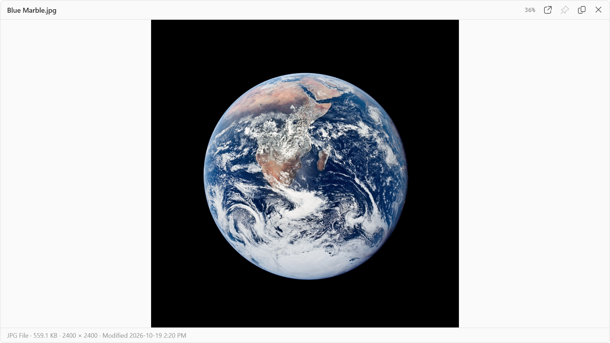

# Peekee

**A quick look at any file, for Windows.** Select a file and press **Space**: Peekee shows it at once, without opening an app. Press **Space** or **Esc** to close it.

> If something does not preview the way you expect, please [open an issue](https://github.com/markticulous/Peekee/issues).

## Download

**[⬇ Download Peekee for Windows](https://github.com/markticulous/Peekee/releases/latest)**, then run **`Peekee-win-Setup.exe`**.

- Installs for your Windows account only. No administrator password needed.
- If Windows says **"Windows protected your PC"**, click **More info → Run anyway**. Peekee is new and is not code-signed yet.
- If double-clicking does nothing, Windows has blocked the download: right-click the file → **Properties** → tick **Unblock** → **OK**, then run it again.
- Needs Windows 10 or 11. If your PC does not have the .NET 10 Desktop Runtime, the installer fetches it.

Peekee updates itself in the background. You never need to download it again.

## How to use it

1. Select a file in **File Explorer**, on the **Desktop**, or in an app's **Open** or **Save** dialog.
2. Press **Space**. The preview opens.
3. Use the **arrow keys** to move to the next file; the preview follows. Press **Space** or **Esc** to close.

The full **User Guide** opens from **Settings → User Guide** inside Peekee, or [online](https://markticulous.com/support/guides/peekee/).

## What it shows

- **Pictures**, including HEIC when Windows has the codec, JPEG XL and AVIF (with Windows' codec or the optional Extra picture formats download in Settings), **Photoshop** files, and classic Amiga IFF pictures.
- **Text and code**, **CSV** and **JSON**, **Markdown** and **SVG**, drawn by Peekee itself.
- **Archives**: zip, 7-Zip, RAR, ISO, tar, CAB and LZH, as a list of what is inside.
- **PDF**, **Illustrator** and **Office** files, and the text of **WordPerfect** documents.
- **Fonts** and **folders**. Anything else gets a card with its details.

The full list is in the [User Guide](https://markticulous.com/support/guides/peekee/#types).

## Light on your PC

Peekee is built to stay out of the way of your PC:

- **Tiny.** About 4.6 MB installed, and a portable download of about 4 MB. No browser engine, no plugins, no copies of things Windows already has.
- **Light at rest.** About 20 MB of memory while it waits in the tray. Nothing runs in the background apart from a once-a-day update check. Its key watcher does no work unless File Explorer, the Desktop or a file dialog is in front.
- **Fast.** A preview is on screen with its content in under a tenth of a second the first time, and in under 20 milliseconds after that. A 20-megapixel photo is ready in about a tenth of a second.
- **Gone when you are done.** Each preview is unloaded the moment it closes, and memory is back to rest within five seconds.
- **Uses what Windows has.** Windows' own image codecs and PDF engine, and the Office previewers already installed, which run in their own process so a damaged file cannot take Peekee down.

## Your privacy

- Peekee only reads the file you preview, on your PC. Nothing is uploaded.
- No account, no tracking, no analytics. The only network request is the update check to this page.

## Support Peekee

Peekee is free and always will be, with no ads and no tracking. If it saves you time, you can [buy me a coffee on Ko-fi](https://ko-fi.com/markticulous) ([why I build these](https://markticulous.com/support/?app=peekee)). Supporters are thanked in [SUPPORTERS.md](SUPPORTERS.md).

After your 100th preview Peekee shows one small thank-you card, once. **Don't ask again** (the card's own button) means it, and nothing in Peekee is ever locked.

## Feedback

Found a problem or have an idea? [Open an issue](https://github.com/markticulous/Peekee/issues).

---

A Markticulous build · © Markticulous · The photograph in the screenshot is the Apollo 17 "Blue Marble" (NASA, public domain).
